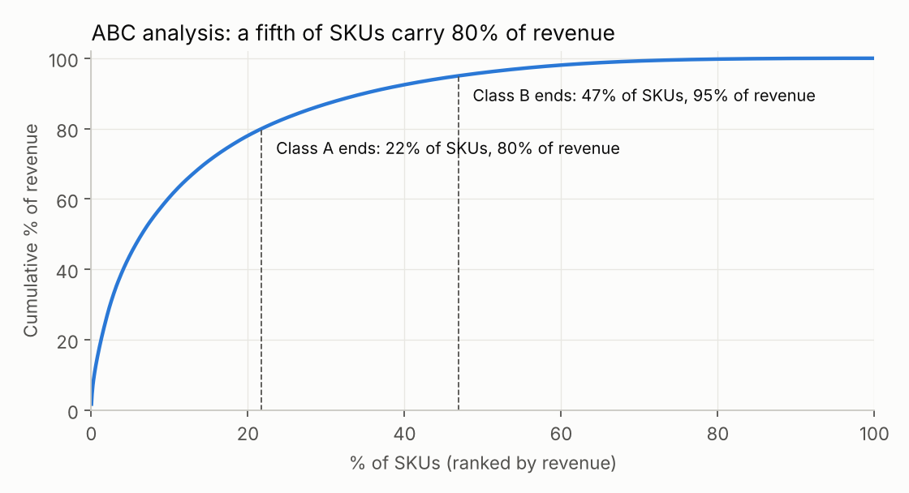
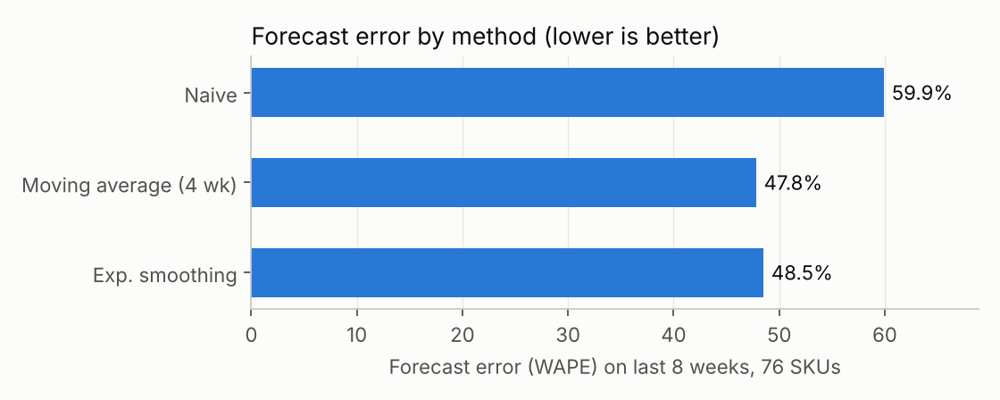
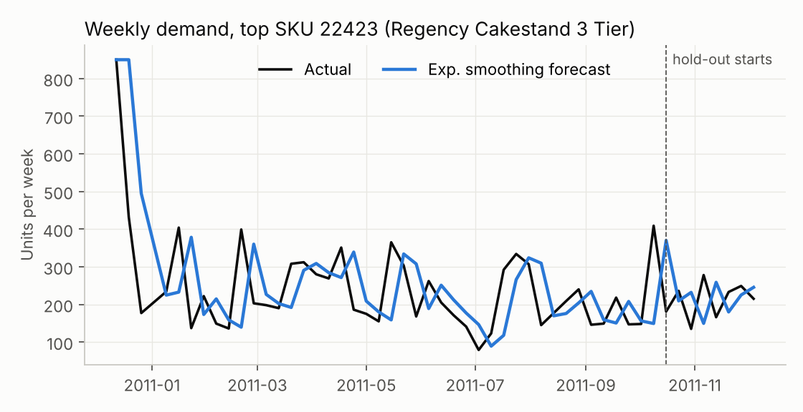

# Inventory Optimisation & Demand Forecasting

Demand forecasting and inventory policy design for an online gift retailer, using one year
of real transaction data (UCI Online Retail, 541,909 invoice lines, Dec 2010 to Dec 2011).

**Tools:** Python (pandas, NumPy, matplotlib), Excel

## What the project answers

1. Which products matter most? (ABC analysis)
2. How well can simple models forecast weekly demand?
3. How much should be ordered, and when? (EOQ, safety stock, reorder point)

## Results

| Question | Result |
|---|---|
| ABC analysis | 847 of 3,895 SKUs (22%) generate 80% of revenue (class A); 53% of SKUs (class C) generate only 5% |
| Best forecast | 4-week moving average: 47.8% WAPE on an 8-week hold-out, against 59.9% for the naive "same as last week" forecast (a 20% reduction in error) |
| Exponential smoothing | 48.5% WAPE, almost as good as the moving average |
| Inventory policy | EOQ ordering gives a modelled ordering + holding cost of GBP 39,727 per year for the 76 SKUs studied, 4.2% below ordering every month (GBP 41,452) |





### Reading the results honestly

- A forecast error near 48% is high. Weekly demand for a single gift product is noisy, and
  the hold-out period (mid-October to early December) is the Christmas ramp-up, which
  level-only models cannot anticipate. A seasonal model would need more than one year of data.
- The 4.2% cost saving is small because monthly ordering is already close to the optimum for
  many of these SKUs. The larger value of the policy is the safety stock and reorder point,
  which are sized from the measured forecast error.
- Ordering cost, holding rate and lead time are assumptions, not data. They are inputs in
  the Excel workbook so they can be changed.

## Method

1. **Cleaning** (`src/analysis.py`): remove cancelled invoices, the sales lines they cancel,
   non-positive quantities and prices, and non-product codes (postage, fees).
   541,909 rows become 522,418.
2. **ABC classification**: rank SKUs by revenue; A = first 80% of cumulative revenue,
   B = next 15%, C = last 5%.
3. **Forecasting**: weekly demand for the top-100 revenue SKUs that sold in at least 90% of
   weeks (76 SKUs). The last 8 of 51 weeks are held out. Three one-step-ahead models:
   naive, 4-week moving average, simple exponential smoothing (alpha tuned on the training
   weeks only). Metric: WAPE = sum of absolute errors / sum of actual demand.
4. **Inventory policy**, per SKU:
   - EOQ = sqrt(2 x annual demand x ordering cost / holding cost per unit-year)
   - Safety stock = z x (std dev of weekly forecast error) x sqrt(lead time)
   - Reorder point = weekly demand x lead time + safety stock

   | Assumption | Value |
   |---|---|
   | Ordering cost | GBP 25 per order |
   | Holding cost | 20% of unit price per year |
   | Lead time | 2 weeks |
   | Service level | 95% (z = 1.645) |

## Files

| Path | Contents |
|---|---|
| `src/download_data.py` | Downloads the raw dataset (45 MB, not stored in this repo) |
| `src/analysis.py` | Cleaning, ABC, forecasting, inventory policy, figures |
| `src/build_workbook.py` | Builds the Excel model with live formulas |
| `outputs/inventory_policy.xlsx` | EOQ / safety stock / reorder point for 76 SKUs; change the blue cells on the Assumptions sheet |
| `outputs/*.csv` | ABC classes, forecast accuracy, policy table |
| `data/weekly_demand_top_skus.csv` | Cleaned weekly demand used for forecasting |

## Run it

```bash
pip install -r requirements.txt
python src/download_data.py
python src/analysis.py
python src/build_workbook.py
```

## Data source

Chen, D. (2015). *Online Retail* [Dataset]. UCI Machine Learning Repository.
https://doi.org/10.24432/C5BW33 (CC BY 4.0)
